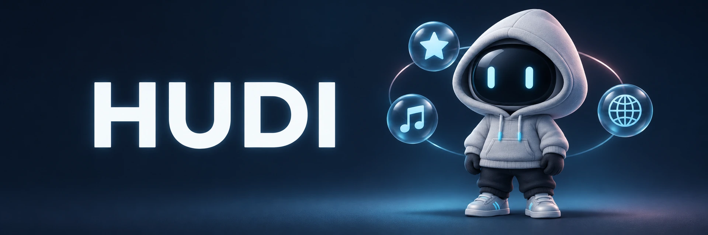

<p align="center">
  
</p>

<h1 align="center">Питомцы для рабочего стола</h1>

<p align="center">
  Выберите персонажа, запустите его поверх окон и настройте, как он будет реагировать на ваши действия.
  Из меню питомца можно открывать сайты и приложения, вести заметки и общаться с моделью.
</p>

<p align="center">
  <a href="https://github.com/GamoffVad/HUDI/releases/latest"><strong>Скачать HUDI</strong></a>
  · <a href="#питомцы">Питомцы</a>
  · <a href="#управление">Управление</a>
  · <a href="#сборка">Сборка</a>
</p>

## Скачать HUDI 7.3.25

| Система | Сборка |
| --- | --- |
| Windows x64 | [Установщик HUDI](https://github.com/GamoffVad/HUDI/releases/download/v7.3.25/HUDI.Setup.exe) |
| macOS 14+ · Apple Silicon | [Архив HUDI.app](https://github.com/GamoffVad/HUDI/releases/download/v7.3.25/HUDI-7.3.25-macOS-arm64.zip) |
| macOS 14+ · Intel | [Архив HUDI.app](https://github.com/GamoffVad/HUDI/releases/download/v7.3.25/HUDI-7.3.25-macOS-x64.zip) |

Сборки macOS предназначены для тестирования. Архивы проверены, запуск на Mac и нотариализация Apple ещё впереди. Реакция на копирование пока доступна в Windows. [Подробности по macOS](docs/macos.md).

## Питомцы

<table>
  <tr>
    <td align="center" width="20%"><br><strong>Худи</strong><br>Встроен</td>
    <td align="center" width="20%"><br><strong>Девочка в розовом</strong><br><a href="https://github.com/GamoffVad/HUDI/releases/download/v7.3.19/Kitty-Girl.pet">Пакет</a></td>
    <td align="center" width="20%"><br><strong>Девушка в очках</strong><br><a href="https://github.com/GamoffVad/HUDI/releases/download/v7.3.10/Glasses-Girl-3.pet">Пакет</a></td>
    <td align="center" width="20%"><br><strong>Инк</strong><br><a href="https://github.com/GamoffVad/HUDI/releases/download/v7.3.19/Ink.pet">Пакет</a></td>
    <td align="center" width="20%"><br><strong>Кудряшка</strong><br><a href="https://github.com/GamoffVad/HUDI/releases/download/kudryashka-v1.3.0/Kudryashka-1.3.0.pet">Пакет</a></td>
  </tr>
</table>

Откройте «Питомцы → Добавить» и выберите скачанный файл `.pet`. Пакет хранит анимации, тему и значки персонажа и подходит обеим версиям HUDI. [Формат пакета](docs/pet-package-format.md).

## Управление

| Действие | Результат |
| --- | --- |
| Правый клик | Меню, настройки и движения питомца |
| Перетаскивание / прокрутка | Положение / размер питомца |
| Двойной клик | Сферы с избранными сайтами и приложениями |
| Ctrl + двойной клик в Windows / ⌘ + двойной клик в macOS | Заметки |
| Тройной клик | Чат с моделью |

Назначения кликов меняются в настройках. В режиме **«Только при действиях пользователя»** питомец запускает анимации по команде и реагирует на поддерживаемые события. У «Девочки в розовом» можно включить реакции на набор текста, переключение приложений и возвращение после паузы. [Реакции](docs/desktop-reactions.md) · [Избранное](docs/favorite-sites.md) · [Настройки API модели](docs/model-providers.md).

## Сборка

Для сборки нужны .NET SDK 10, Git LFS и Python 3.11 или новее.

```sh
git clone https://github.com/GamoffVad/HUDI.git
cd HUDI
git lfs pull
python tools/fetch-hudi-sprites.py
```

- **Windows** · запустите `powershell -File tools/build.ps1 -SkipPublisher`. Установщик появится в `output/hudi-pet-v7/distribution`.
- **macOS** · запустите `python3 tools/package-macos.py --arch both`. Архивы появятся в `output/hudi-macos`.

[Промпт генерации питомцев](docs/pet-generation-prompt.md) · [Подготовка прозрачных кадров](docs/pet-assets-and-motion.md) · [Навык для работы с питомцами](docs/desktop-pet-builder/SKILL.md)
